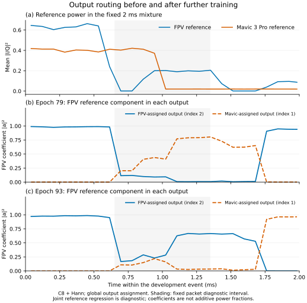

# 같은 패킷 사례의 epoch93 재평가

**후속 방법을 학습하기 전**, 기존100epoch 실행의93저장점을 평가했다.
동일한 FPV/Mavic3Pro2ms 혼합·전력·위상·창·C8·Hann 조건이다.
따라서 아래 개선은 새 순열 학습의 효과가 아니다.

|저장점|FPV NMSE↓|Mavic3Pro NMSE↓|FPV 복소SI-SDR↑|Mavic3Pro 복소SI-SDR↑|
|---|---:|---:|---:|---:|
|79|0.311911|0.394416|3.776dB|2.063dB|
|93|0.113911|0.161044|8.909dB|7.169dB|

FPV에 전역 대응시킨 출력2에서 CRC16·CRC24가 통과한다. 출력1과 배경에도
FPV CRC가 남고 출력0은 통과하지 않았다. Mavic3Pro 정답은 이 사례의 고정 FPV
채널에서 dual-ZC가 검출되지 않았다. 두 기종 식별 성공이나 분리로 인한 검출 향상으로
해석하지 않는다. 혼합 자체도 FPV CRC가 통과한다.

고정 패킷 구간(0.65–1.35ms, +15MHz 채널)에서 FPV 정답에 대한 투영 계수의
제곱은 원하는 출력2에서 **0.4653**, 다른 출력1에서 **0.0808**이다.
다른 출력1의 투영 성분은79의−2.104dB에서93의−10.927dB로 낮아졌다.
이는 정답 기반 진단이며 수신기에 정답이나 보정 배율을 넣은 결과가 아니다.

패킷 가운데 구간의 배정은 좋아졌지만 약1.75ms 이후 별도 FPV 활동은 다른 출력에
우세하게 남는다. 원기록 내 파형/주파수 구성이 바뀌는 상황의 대응은 여전히 진단 대상이다.
저전력 구간의 회귀계수를 신호 활동 또는 원인별 전력 비율로 해석하지 않는다.

현재 전체 검증 최선은 이후 완료된97epoch로 바뀌었다. 본 표는93의 개별 사례이며,
100epoch 완료 뒤 원래 기준으로 최종 선택한 모델을 다시 같은 방식으로 확인한다.
새 방법의 효과는 그 최종 부모와 동일 예산 대조군을 기준으로 판단한다.
